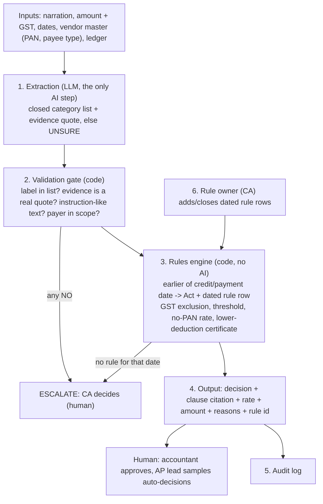

# TDS Classifier with Abstention (prototype)

**Idea in one line:** an LLM may only pick a payment *category*. A dated rules table and a deterministic engine decide the section, rate and amount. Anything unclear goes to a human (a CA).

Jurisdiction: India, resident non-salary payments, Income-tax Act 1961 (before 1 Apr 2026) and Income-tax Act 2025 s.393 (from 1 Apr 2026). Payments from 1 Apr 2024 only. Categories covered: contractor, professional fees, technical services, commission, rent (building / machinery).

## Architecture



## Files
| File | Role |
|---|---|
| `rules.py` | Versioned rule table (rate, threshold, citation, effective dates). Every rule has `verified=False`. |
| `engine.py` | Deterministic decision: earlier of credit/payment date, Act selection, GST exclusion, thresholds, no-PAN rate, lower-deduction certificate, rupee rounding, abstention. |
| `extractor.py` | `keyword_extract` (non-AI baseline), `llm_extract` (OpenRouter, closed-list output, evidence must be a quote from the narration) and a gate that escalates instruction-like text in narrations. |
| `run_tests.py` | 31 synthetic cases (21 main + 10 harder challenge cases), engine-only and end-to-end runs, confident-wrong rate. |

## Run
```bash
python3 run_tests.py            # baseline extractor, no dependencies
export OPENROUTER_API_KEY=...   # optional, free account
export OPENROUTER_MODEL=<a free-tier model id from openrouter.ai/models>
pip install -r requirements.txt   # only needed for --llm
python3 run_tests.py --llm      # LLM extractor
```

Example output (last lines):
```
B) end-to-end: {'PASS': 18, 'SAFE_MISS': 1, 'WRONG_CONFIDENT': 2}   confident-wrong rate: 2/21 = 10%
B) end-to-end: {'PASS': 6, 'SAFE_MISS': 3, 'WRONG_CONFIDENT': 1}   confident-wrong rate: 1/10 = 10%
ALL 31: {'PASS': 24, 'SAFE_MISS': 4, 'WRONG_CONFIDENT': 3}   confident-wrong rate: 3/31 = 10%
```

## Data
All 31 narrations, vendors and amounts are **made up**. No real client or personal data.

## Results (keyword baseline, as run)
Verdicts: **PASS** matches the expected answer; **SAFE_MISS** the pipeline escalated to a human although an answer existed; **WRONG_CONFIDENT** the pipeline auto-decided something wrong or something a human should have seen (the dangerous failure).

| Set | Engine only (gold category) | End-to-end PASS | SAFE_MISS | WRONG_CONFIDENT |
|---|---|---|---|---|
| Main (21) | 21/21 | 18 | 1 | 2 |
| Challenge (10) | 10/10 | 6 | 3 | 1 |
| **All (31)** | 31/31 | **24** | **4** | **3 (10%)** |

Where it fails:
- **Cases 16, 107, 109 (SAFE_MISS):** no keyword matched. "Drafting of shareholder agreement", "Prof. fee: CA firm" and "Consulting fee" (the keyword is `consultan`, which does not match "consulting") escalate. **Case 104:** "Brokerage for lease of godown" matched two categories (commission and rent), so it escalated. Safe but unhelpful. This is the reason an LLM reader is needed.
- **Case 17 (WRONG_CONFIDENT):** "Rent-a-cab monthly vehicle hire" is auto-classified as building rent; vehicle hire is a genuine gray area a human should see.
- **Case 18 (WRONG_CONFIDENT):** "Professional tax payment - municipal corporation" matches `professional` and would wrongly deduct 10% TDS from a government levy.
- **Case 110 (WRONG_CONFIDENT):** "Hire of excavator with operator" is auto-classified as machinery rent; with an operator it may be a contract. A human should see it.

The injection-style narration (case 106) is escalated by the gate before any extractor sees it.

## Limitations (read before trusting)
- **The LLM extractor was not run.** The build sandbox had no access to OpenRouter. Its safeguards (closed list, evidence-quote check, abstain on anything else) are implemented but unmeasured. Run `--llm` and record which model you used and the numbers.
- **Test cases and expected answers were written by one person in one session.** The 10 challenge cases were written after the baseline and the keywords were not tuned on them, but the numbers are still illustrative, not a benchmark. "Engine only" passing checks the code against my own expectations, not legal correctness.
- **Rules are unverified.** They come from secondary sources and general knowledge. Two known discrepancies are flagged in `rules.py` (contractor 194C/194M thresholds, new-Act rent threshold). Check against the Act text on the Income Tax Department portal before any real use.
- **Simplifying assumption:** when a payment crosses the annual threshold, TDS is computed on the full aggregate. Practice varies; a CA must confirm.
- **Coverage is narrow:** 5 categories. Out of scope: non-residents, salary, TCS, payer = unaudited individual/HUF, 15G/15H declarations, filing returns, tax-treaty rates.
- Amounts, dates and payee type are given as structured fields; only the *category* is extracted from text.
- The injection gate is a simple pattern check, not a complete defence.
